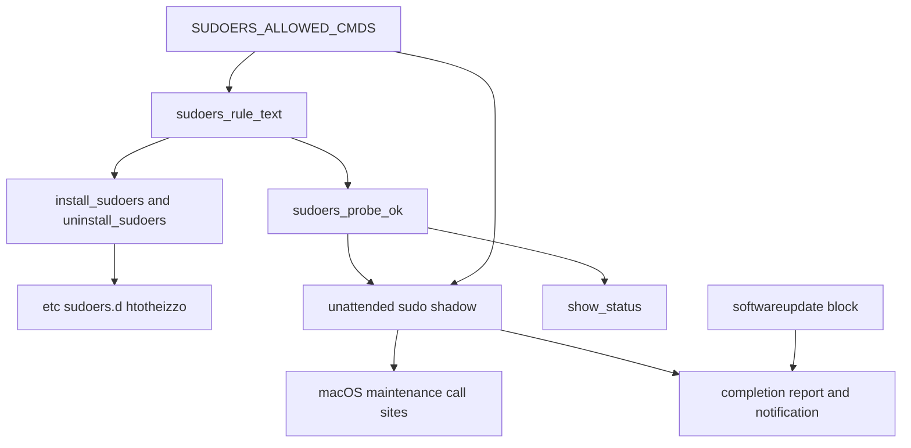
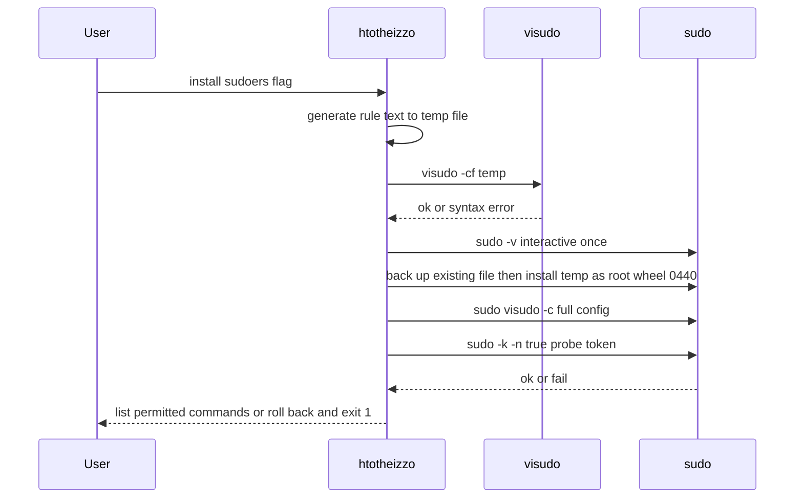
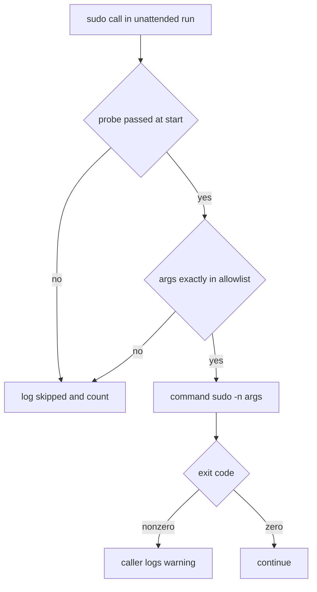

# Design Document: unattended-sudo

## Overview
**Purpose**: Let the daily unattended run of htotheizzo perform a fixed set of low-risk maintenance commands that need root, without prompts or stored secrets, and report honestly what it could not do.
**Users**: The Mac's owner, who relies on the `com.htotheizzo.daily` launchd agent and occasionally runs htotheizzo by hand.
**Impact**: Adds a one-time `--install-sudoers` / `--uninstall-sudoers` flow that manages `/etc/sudoers.d/htotheizzo`; changes the unattended sudo shadow from "always skip" to "run if allowlisted and the rule is current, else skip"; stops installing macOS updates in unattended runs (reporting them instead); makes the Spotlight rebuild opt-in.

### Goals
- Unattended runs perform the allowlisted maintenance commands with zero prompts (3.1, 3.3).
- One source of truth for permitted commands, with detectable drift (1.1, 2.4).
- No change to attended-run behavior (4.1 to 4.3).

### Non-Goals
- Installing macOS updates unattended; Touch ID flows; storing passwords.
- Allowlisting `gem`, `port`, `tmutil localsnapshot`, `mdutil`, `softwareupdate`.
- Linux/Windows.

## Boundary Commitments

### This Spec Owns
- The allowlist of root commands permitted in unattended runs (`SUDOERS_ALLOWED_CMDS`) and the sudoers rule generated from it.
- Installing, uninstalling and probing `/etc/sudoers.d/htotheizzo`.
- The unattended `sudo` shadow function's decision logic and skip accounting.
- Unattended handling of the softwareupdate block (list + report, no install) and the pending-update notification text.
- Spotlight rebuild gating.
- Help text, README section, and the steering note on adding root steps.

### Out of Boundary
- Attended authentication (`sudo -v`, `keep_sudo_alive`) and the major-upgrade warning (owned by `sudo-auth`).
- The launchd agent plist and `--install-launchd` (unchanged).
- `/etc/pam.d/*` and Touch ID configuration.
- Time Machine doctor failures reaching the summary (issue #30).
- Linux/Windows sudo call sites (they never run under `UNATTENDED` on macOS; the shadow function's default-deny still applies if they did).

### Allowed Dependencies
- Existing helpers in `htotheizzo.sh`: `log`, `send_notification`, `show_error_summary`, `should_run`, `command_exists`, `run_with_fallback`, `UNATTENDED`, `MOCK_MODE`, `SKIP_SUDO`, `SUDO_SKIPPED_COUNT`.
- macOS system tools only: `/usr/sbin/visudo`, `/usr/bin/sudo`, `/usr/bin/install`, `/usr/bin/shasum`, `/usr/bin/defaults`, `/usr/sbin/softwareupdate`. No new third-party dependencies.
- Dependency direction: allowlist data, then rule generator, then installer/probe, then unattended wrapper and status/report. The wrapper never writes the sudoers file; the installer never runs maintenance commands.

### Revalidation Triggers
- Any change to `SUDOERS_ALLOWED_CMDS` (requires users to re-run `--install-sudoers`; probe hash changes).
- Any new `sudo` call site in the macOS path that should run unattended (must be added to the allowlist with exact args).
- Changes to how `update()` detects or enters unattended mode.
- Changes to completion-notification wording consumed by `show_status()`'s log parsing.

## Architecture

### Existing Architecture Analysis
- Single bash script, `set -euo pipefail`, flags parsed at the bottom (`--status`, `--install-launchd`, `--unattended`).
- Unattended mode probes `sudo -n true`; on failure defines a shell function `sudo` that logs `Skipped (needs sudo): sudo $*`, increments `SUDO_SKIPPED_COUNT`, returns 0. Because it is a function, it also applies inside `eval` (`run_with_fallback`).
- Call sites invoke binaries by bare name (`sudo purge`).

### Architecture Pattern & Boundary Map


**Architecture Integration**:
- Selected pattern: data-driven allowlist with default-deny wrapper (extends the existing shadow-function pattern).
- Existing patterns preserved: `|| log "Warning: ..."`, `should_run`, flag parsing, `show_status` sections, single notification point.
- New components rationale: generator and probe are needed so rule, wrapper and status agree without reading a root-only file.
- Steering compliance: no new dependencies; strict mode preserved; mock/skip modes respected.

### Technology Stack
| Layer | Choice / Version | Role in Feature | Notes |
|-------|------------------|-----------------|-------|
| CLI | Bash (`htotheizzo.sh`) | All logic | macOS `/bin/bash` 3.2 compatible constructs only (no assoc arrays) |
| Runtime | sudo 1.9.x (macOS), visudo | Rule enforcement and validation | `visudo -cf` works unprivileged |
| Data | `/etc/sudoers.d/htotheizzo` | Installed rule | root:wheel 0440 |

## File Structure Plan

### Modified Files
- `htotheizzo.sh`
  - Top-level constants (near `UNATTENDED`/`SUDO_SKIPPED_COUNT`, initialized for `set -u`): `SUDOERS_FILE="${HTOTHEIZZO_SUDOERS_FILE:-/etc/sudoers.d/htotheizzo}"` (override used only by tests for the existence check; install/uninstall refuse any path other than the default unless `HTOTHEIZZO_TEST=1`), `SUDOERS_ALLOWED_CMDS` array, `SUDOERS_ACTIVE=0`, `PENDING_OS_UPDATES=0`.
  - New functions (placed next to the launchd helpers, around `install_launchd_agent`/`show_status`): `sudoers_rule_body`, `sudoers_probe_token`, `sudoers_rule_text`, `sudoers_validate_file <path>`, `sudoers_probe_ok`, `install_sudoers`, `uninstall_sudoers`, `sudo_cmd_allowed`.
  - `update()` unattended branch: probe + new shadow function.
  - macOS call sites: absolute paths and exact args matching the allowlist (`mac_disk_maintenance`, `mac_system_maintenance`); `mac_system_maintenance` calls `/usr/libexec/locate.updatedb` unconditionally (the `periodic` branch is removed; `periodic` no longer ships on current macOS).
  - `sudo gem update` / `sudo gem cleanup` (inside a command substitution, where the shadow function's counter increment would be lost): in unattended mode the gem block logs "Skipped (needs sudo): gem update" and increments `SUDO_SKIPPED_COUNT` in the parent shell before reaching the substitution.
  - softwareupdate block: unattended path lists and reports only; sets `PENDING_OS_UPDATES`.
  - `mac_spotlight_rebuild` gating: opt-in.
  - Completion: skipped-count and pending-OS-update suffixes on the notification; Automatic Updates hint.
  - `show_status()`: new "Unattended sudo rule" section.
  - Help text and flag parsing: `--install-sudoers`, `--uninstall-sudoers`; `spotlight_rebuild=1` documented.
- `test.sh` — test harness additions (see Testing Strategy) and new tests for rule generation, validation, wrapper decisions, spotlight gating, softwareupdate unattended path, notifications.
- `README.md` — "Unattended sudo" section.
- `.kiro/steering/tech.md` — rule for adding root steps; `spotlight_rebuild` flag.

## System Flows

### Install

- Rollback on any failure after the copy: restore the backup if one existed, else remove the file; all in the same authenticated session.

### Unattended sudo decision


## Requirements Traceability

| Requirement | Summary | Components | Interfaces | Flows |
|-------------|---------|------------|------------|-------|
| 1.1 | Rule covers exact list | Allowlist, RuleGen | `sudoers_rule_text` | Install |
| 1.2 | Validate before activate | Installer | `install_sudoers` | Install |
| 1.3 | Invalid: keep old, exit 1 | Installer | `install_sudoers` | Install |
| 1.4 | Print list and location | Installer | `install_sudoers` | Install |
| 1.5 | Idempotent | Installer, RuleGen | deterministic text | Install |
| 1.6 | No shell/wildcards/user files | Allowlist, RuleGen | allowlist invariants | n/a |
| 1.7 | root-owned, not user-writable | Installer | `install -o root -g wheel -m 0440` | Install |
| 1.8 | macOS only | Installer | OS guard | n/a |
| 1.9 | One interactive auth, no stored password | Installer | `sudo -v` | Install |
| 2.1 | Uninstall | Installer | `uninstall_sudoers` | n/a |
| 2.2 | Uninstall when absent | Installer | `uninstall_sudoers` | n/a |
| 2.3 | Status shows installed | Status, Probe | `show_status`, `sudoers_probe_ok` | n/a |
| 2.4 | Status shows outdated | Status, Probe | probe token hash | n/a |
| 3.1 | Run permitted unattended | Wrapper | `sudo_cmd_allowed`, shadow `sudo` | Decision |
| 3.2 | Skip and count others | Wrapper | shadow `sudo` | Decision |
| 3.3 | Never prompt or wait | Wrapper | `sudo -n`, stdin /dev/null | Decision |
| 3.4 | No rule: today's behavior | Wrapper, Probe | probe gate | Decision |
| 3.5 | Skipped count in log and notification | Report | completion block | n/a |
| 3.6 | Permitted failure warns and continues | Call sites | `|| log "Warning"` | Decision |
| 4.1 | Attended unchanged | update() | existing `sudo -v` branch | n/a |
| 4.2 | Attended unchanged with rule | update() | wrapper only defined when unattended | n/a |
| 4.3 | Mock / SKIP_SUDO unchanged | update() | existing branch order | n/a |
| 5.1 | No OS install unattended | SWU block | unattended guard | n/a |
| 5.2 | Log and notify pending | SWU block, Report | `PENDING_OS_UPDATES` | n/a |
| 5.3 | No mention when none | Report | conditional suffix | n/a |
| 5.4 | Automatic Updates hint when reliably off | Report | `defaults read` key equals 0 | n/a |
| 5.5 | Not counted as failure | SWU block | no ERROR_LOG entry, no skip count | n/a |
| 6.1 | Spotlight opt-in | Spotlight gate | `spotlight_rebuild` / `only_spotlight` | n/a |
| 6.2 | Rebuild when requested attended | Spotlight gate | existing `mdutil` call | n/a |
| 6.3 | Help documents opt-in | Help text | usage | n/a |
| 7.1 | Help lists new flags | Help text | usage | n/a |
| 7.2 | README section | README | n/a | n/a |
| 7.3 | Steering rule | tech.md | n/a | n/a |

## Components and Interfaces

| Component | Domain/Layer | Intent | Req Coverage | Key Dependencies | Contracts |
|-----------|--------------|--------|--------------|------------------|-----------|
| Allowlist | Data | Exact permitted command lines | 1.1, 1.6 | none | State |
| RuleGen | Core | Deterministic rule text and probe token | 1.1, 1.5, 2.4 | Allowlist (P0), shasum (P0) | Service |
| Installer | Setup | Install/uninstall with validation and rollback | 1.2 to 1.9, 2.1, 2.2 | RuleGen (P0), visudo, sudo (P0) | Service |
| Probe | Core | "Current rule active?" without reading the file | 2.3, 2.4, 3.4 | RuleGen (P0), sudo (P0) | Service |
| Wrapper | Runtime | Unattended default-deny sudo | 3.1 to 3.4, 4.2 | Allowlist, Probe (P0) | Service |
| SWU unattended path | Runtime | List and report OS updates | 5.1 to 5.5 | softwareupdate (P1) | State |
| Report | Runtime | Notification and hint text | 3.5, 5.2 to 5.4 | send_notification (P1), defaults (P2) | n/a |
| Status | CLI | Rule section in `--status` | 2.3, 2.4 | Probe (P0) | n/a |
| Spotlight gate | Runtime | Opt-in rebuild | 6.1, 6.2 | should_run (P2) | n/a |
| Docs | Docs | Help, README, steering | 6.3, 7.1 to 7.3 | n/a | n/a |

### Data

#### Allowlist (`SUDOERS_ALLOWED_CMDS`)
| Field | Detail |
|-------|--------|
| Intent | Exact command lines (absolute path + exact args) permitted unattended |
| Requirements | 1.1, 1.6 |

Entries (a command with no arguments is written bare; the rule renders it with `""`):
```
/usr/sbin/diskutil verifyVolume /
/usr/sbin/purge
/usr/libexec/locate.updatedb
/usr/bin/dscacheutil -flushcache
/usr/bin/killall -HUP mDNSResponder
```
Deliberately excluded (stay attended-only): `xcodebuild -license accept` (the `/usr/bin/xcodebuild` shim runs whichever Xcode `xcode-select` points at, as root; that bundle can be user-owned) and `periodic daily weekly monthly` (runs every script in the local periodic directories, including `/usr/local/etc/periodic`, which can be user-writable; also absent on macOS 27). The list is host-independent, so the rule text and probe token are identical on every Mac for the same user.
**Invariants** (checked by a test): every entry starts with `/usr/bin/`, `/usr/sbin/` or `/usr/libexec/`; no entry contains `*`, `?`, `[`, `\`, `,`, `:`, `=`, `!`, `"`; no entry names a shell (`sh`, `bash`, `zsh`, `env`, `osascript`), `sudo`, `su`, or htotheizzo itself.

### Core

#### RuleGen
**Contracts**: Service [x]
```bash
# stdout: rule body lines, one "  <cmd>" per allowlist entry, bare commands rendered as '<cmd> ""'
sudoers_rule_body
# stdout: "htotheizzo-probe-<first 8 hex of sha256(user + rule body)>"
sudoers_probe_token
# stdout: full file text:
#   comment header (generated by htotheizzo, do not edit, how to remove)
#   <user> ALL=(root) NOPASSWD: <cmd1>, <cmd2>, ..., /usr/bin/true <probe token>
sudoers_rule_text
# 0 iff `visudo -cf <path>` accepts the file; prints visudo output on failure
sudoers_validate_file <path>
```
- Preconditions: `id -un` returns a name of `[A-Za-z0-9._-]` only; otherwise callers abort with an error.
- Postconditions: output is byte-identical for identical user and allowlist (1.5).

#### Probe
```bash
# returns 0 iff the current rule is installed and effective
sudoers_probe_ok   # runs: command sudo -k -n /usr/bin/true "$(sudoers_probe_token)" </dev/null >/dev/null 2>&1
```
- `-k` ignores cached credentials for this call only, so an attended `sudo -v` earlier does not cause a false positive.

### Setup

#### Installer
**Contracts**: Service [x]
```bash
install_sudoers     # exit 0 on success; 1 on non-macOS, invalid rule, install failure, or ineffective rule
uninstall_sudoers   # exit 0 if removed or nothing installed; 1 on removal failure
```
Install steps: OS guard (1.8) => generate to `mktemp` => `sudoers_validate_file` (1.2, 1.3: on failure print visudo output, exit 1, nothing touched) => `sudo -v` (1.9) => if `$SUDOERS_FILE` exists, `sudo cp -p` it to a root-only backup in the same dir with a name containing `.` (so sudo ignores it) => `sudo install -o root -g wheel -m 0440 tmp $SUDOERS_FILE` (1.7) => `sudo visudo -c` => `sudoers_probe_ok` => on any failure restore backup or remove file and exit 1 => on success remove backup, print the permitted list, file path and how to remove (1.4).

### Runtime

#### Wrapper (unattended `sudo` shadow)
**Contracts**: Service [x]
```bash
sudo_cmd_allowed "$@"   # 0 iff "$*" equals an allowlist entry exactly
# defined only when UNATTENDED is set and SKIP_SUDO/MOCK_MODE are not:
sudo() {
  if [[ $SUDOERS_ACTIVE -eq 1 ]] && sudo_cmd_allowed "$@"; then
    command sudo -n "$@" </dev/null; return $?
  fi
  SUDO_SKIPPED_COUNT=$((SUDO_SKIPPED_COUNT + 1)); log "Skipped (needs sudo): sudo $*"; return 0
}
```
- `SUDOERS_ACTIVE` is set once at the start of the unattended branch with an `if sudoers_probe_ok; then SUDOERS_ACTIVE=1; fi` form (never `probe && x=1` as a last statement, which returns 1 under `set -e`), logged as "Unattended run: sudo rule active (N commands permitted)" or "no sudo rule; steps that need sudo will be skipped".
- The existing `sudo -n true` fast path (credentials genuinely available) is kept unchanged.

#### Call sites
- Change to absolute paths and the exact allowlist forms: `sudo /usr/sbin/diskutil verifyVolume /`, `sudo /usr/sbin/purge`, `sudo /usr/libexec/locate.updatedb`, `sudo /usr/bin/dscacheutil -flushcache`, `run_with_fallback "sudo /usr/bin/killall -HUP mDNSResponder" ...`.
- Redirections (`2>/dev/null`) stay outside the argument list, so matching is unaffected.

#### softwareupdate unattended path
- After the existing `softwareupdate --list` and log, when `UNATTENDED` is set: count lines matching `^\* Label:` into `PENDING_OS_UPDATES` (`grep -c ... || true`, since `grep -c` exits 1 on zero matches under `set -e`); log "macOS updates pending: N; install via System Settings (Automatic Updates) or an attended htotheizzo run"; skip the major-upgrade/stdinpass/install logic entirely. No `ERROR_LOG` entry, no `SUDO_SKIPPED_COUNT` increment (5.5).

#### Report
- The two completion notifications gain suffixes: `; N admin step(s) skipped` when `SUDO_SKIPPED_COUNT > 0` (3.5), `; macOS updates pending` when `PENDING_OS_UPDATES > 0` (5.2, 5.3).
- The existing "Note: N step(s) needing sudo were skipped" log line stays (it is parsed by `show_status`); its advice becomes "run htotheizzo manually or --install-sudoers" when the rule is not active.
- Automatic Updates hint (5.4): when `PENDING_OS_UPDATES > 0` and `defaults read /Library/Preferences/com.apple.SoftwareUpdate AutomaticallyInstallMacOSUpdates` prints exactly `0` (read with `|| true`; a missing key exits non-zero), log "Tip: turn on System Settings > General > Software Update > Automatic Updates". Any other output or error: no hint.

#### Spotlight gate
- `mac_spotlight_rebuild` runs only when `spotlight_rebuild=1` or `only_spotlight=1`, and `skip_spotlight` is unset. Otherwise nothing is logged beyond a debug-level "Spotlight rebuild not requested" line.

### CLI
#### Status
New section in `show_status()`:
```
Unattended sudo rule (/etc/sudoers.d/htotheizzo):
  active (5 commands permitted)            # probe ok; count = ${#SUDOERS_ALLOWED_CMDS[@]}, probe entry not counted
  installed but outdated: re-run --install-sudoers   # file exists, probe fails
  not installed (run --install-sudoers)     # no file
```

## Error Handling
- Invalid rule (1.3): visudo output shown, exit 1, no system change.
- Auth cancelled during install: exit 1, no system change.
- Post-install validation or probe failure: rollback, exit 1, message names the cause ("sudoers syntax", "rule not effective: is #includedir present in /etc/sudoers?").
- Unattended permitted command fails: caller's `|| log "Warning: ..."` adds to `ERROR_LOG` as today (3.6).
- `id -un` with unsafe characters: install aborts with an error.

## Testing Strategy
Tests live in `test.sh`, use stubs, never touch `/etc` or run the real `sudo`.

**Harness (prerequisite)**:
- Function extraction extended (existing sed pattern, as in `load_cleanup_helpers`) to also pull the `SUDOERS_*` constants and allowlist array, since `htotheizzo.sh` calls `main` and cannot be sourced.
- A stub bin dir first on `PATH` with recording stubs: `sudo` (rejects `-n true`; accepts `-k -n /usr/bin/true <token>` only when `STUB_SUDO_TOKEN` matches; records every other invocation's args to a file and exits 0), `softwareupdate` (`--list` prints `STUB_SWU_LIST`), `osascript` (exit 0, so `send_notification` logs "Notification sent: ..."), `defaults` (prints `STUB_AUTO_UPDATE` or exits 1), `mdutil` (records).
- `run_unattended_fast`: a non-mock run with `--unattended` (or `UNATTENDED=1`), `HOME` pointed at a temp dir, `only_*` selection of the sections under test, and the stub `PATH`. Because the unattended branch runs only when `MOCK_MODE` is unset, the real-`sudo` guard is the stub `sudo`; the harness aborts if `command -v sudo` is not the stub.
- **Unit**
  - `sudoers_rule_text` passes `visudo -cf` and is byte-identical across two calls (1.2, 1.5).
  - Allowlist invariants: absolute system paths, no wildcard/shell/meta characters (1.6).
  - Probe token changes when the allowlist changes (2.4).
  - `sudo_cmd_allowed`: exact match accepted; extra arg, missing arg, bare name (`purge`), different path rejected (3.1, 3.2).
- **Integration (stubbed `sudo` first on PATH recording its args)**
  - Unattended + probe ok: allowlisted call reaches stub with `-n`; non-allowlisted call is skipped and counted (3.1, 3.2, 3.3).
  - Unattended + probe fails: every call skipped, stub never invoked except the probe (3.4).
  - Unattended + stubbed `softwareupdate --list` with 2 labels: no install call, log shows "pending: 2", notification text contains "macOS updates pending" (5.1, 5.2, 5.5); with 0 labels, no mention (5.3).
  - Spotlight: default run never reaches the stub `sudo` with `mdutil -E /`; with `spotlight_rebuild=1` the stub `sudo` records `mdutil -E /` (6.1, 6.2). `mac_spotlight_rebuild` bypasses `maybe_run`, so the stub `sudo` is mandatory here.
  - `--install-sudoers` on a non-darwin `OSTYPE` exits 1 with "macOS only" (1.8).
  - `sudoers_validate_file` rejects a deliberately broken temp file (1.3); install with a stub `sudo` exits before any `install` call when validation fails.
  - Strict mode: an unattended run with zero pending updates and a missing Automatic Updates key completes with exit 0.
- **Manual (real machine, once)**: `--install-sudoers` (one Touch ID), `--status` shows active, `launchctl kickstart` the agent, log shows the 5 permitted commands run, and only non-permitted steps (e.g. `xcodebuild -license accept`, `gem`) are skipped and counted; `ls -l /etc/sudoers.d/` shows `htotheizzo` as `-r--r----- root wheel` and no leftover backup file; `--uninstall-sudoers` then `--status` shows not installed.

## Security Considerations
- Trade-off (documented): any process running as the user can run exactly these commands as root without a password. Impact is limited to cache flushes, memory purge, volume verification, locate DB update.
- No shell, wildcard or user-writable target in the rule; the file is root:wheel 0440 and validated before and after install.
- `xcodebuild` and `periodic` are excluded because they execute code from locations the user may control.
- The probe entry runs `/usr/bin/true` with one fixed argument: no capability gained.
