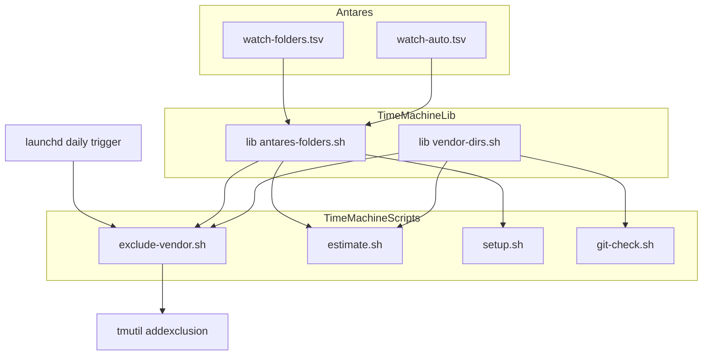
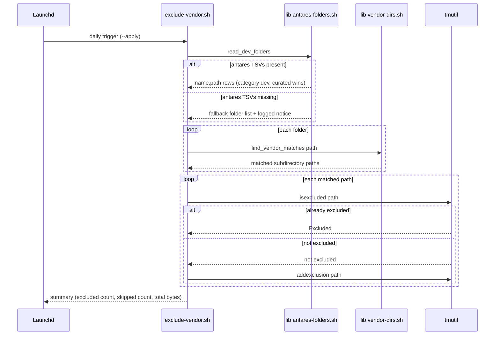

# Design Document: vendor-exclusion

## Overview

**Purpose**: This feature stops Time Machine from backing up reconstructible dev-dependency directories (`node_modules`, `.venv`, build output, …) by reusing folder locations antares already discovers, instead of htotheizzo running its own disk crawl.

**Users**: Yanick, as the operator of both htotheizzo's `time-machine/` toolkit and (on machines where it's installed) antares.

**Impact**: Adds one new script (`exclude-vendor.sh`) and two tiny shared libraries to `time-machine/`, and makes three small, additive changes to `estimate.sh`, `setup.sh`, and `git-check.sh` so they agree with the new script about what counts as reconstructible. No antares file is written to; antares is a read-only upstream data source for this feature.

### Goals
- Exclude vendor/build subdirectories inside antares-tracked `category=dev` folders from Time Machine, without a full disk scan.
- Keep the operation reversible-by-inspection: dry-run by default, explicit `--apply` to act, idempotent on rerun.
- Degrade gracefully to a hardcoded folder list on any machine without antares installed.
- Align `estimate.sh`'s sizing and `git-check.sh`'s risk reporting with the same vendor/build match list, without regressing either script's current behavior.

### Non-Goals
- No antares code changes, and no file under the antares repo or `$ANTARES_HOME` is ever written to (Requirement 7).
- No `category=ai` folders in v1 (Requirement 1.5).
- No persistent background watcher/daemon — a daily scheduled run only (Requirement 4).
- No system-wide crawl of folders antares doesn't already track (replacing `asimov` generally is explicitly out of scope; `RECOMMENDATIONS.md` keeps the `asimov` mention as a fallback note for Macs without antares).
- `setup.sh` auto-adding new exclusion roots is scoped strictly to an explicit pure-cache allow-list (see Decision in `research.md`) — it never wholesale-excludes a mixed project-root tree like `~/Developer` or `~/code`.

## Boundary Commitments

### This Spec Owns
- Discovery of vendor/build subdirectories inside antares' `category=dev` watched folders.
- Deciding which of those subdirectories are Time Machine-excluded, and performing that exclusion via `tmutil`.
- The daily scheduled trigger for that exclusion sweep.
- The shared vendor/build directory-name list and the shared antares-TSV-reading logic used by `exclude-vendor.sh`, `estimate.sh`, `setup.sh`, and `git-check.sh`.
- The explicit pure-cache allow-list that gates which antares-discovered folders `setup.sh` may add to its wholesale exclusion list.

### Out of Boundary
- Anything inside the antares repo or `$ANTARES_HOME` — this spec only reads `watch-folders.tsv` and `watch-auto.tsv`.
- `health-metrics.csv` and `folder-sizes.csv` — not read by this feature (see `research.md`, "Size sourcing scope" decision); `estimate.sh` continues to compute byte totals itself via `du`, only the folder *list* comes from antares.
- Deciding whether antares itself is healthy, installed correctly, or up to date — this feature only checks whether its two TSV files are present and readable.
- Any UI/GUI surface — `time-machine/` scripts are terminal-only, consistent with the rest of the toolkit.

### Allowed Dependencies
- Read-only: `~/Developer/2026/antares/watch-folders.tsv` (or `$ANTARES_DIR/watch-folders.tsv` if `ANTARES_DIR` is set, matching the existing convention in `htotheizzo.sh`'s `update_sparkle_apps()`).
- Read-only: `$ANTARES_HOME/watch-auto.tsv` (default `~/antares/watch-auto.tsv`).
- macOS `tmutil` CLI (`isexcluded`, `addexclusion`) — no `sudo` required for either subcommand.
- macOS `launchd` for the daily schedule.

### Revalidation Triggers
- antares changes the column shape, delimiter, or semantics of `watch-folders.tsv`/`watch-auto.tsv`.
- antares renames or relocates `$ANTARES_HOME` or the antares repo's default path.
- The canonical vendor/build directory-name list (Requirement 2.1) changes — any addition/removal must be mirrored in `lib/vendor-dirs.sh` and therefore in `exclude-vendor.sh`, `estimate.sh`, and `git-check.sh` simultaneously, since they share the one list.
- antares adds a new `category=dev` row that is a pure cache — the `PURE_CACHE_ROW_NAMES` allow-list in `setup.sh` needs a manual addition to pick it up (by design — see `research.md`).

## Architecture

### Existing Architecture Analysis

`time-machine/` is five independent, uncoupled bash scripts (`setup.sh`, `doctor.sh`, `estimate.sh`, `git-check.sh`, `backup.sh`), each with its own inline color helpers and a `set -euo pipefail`/`set -uo pipefail` header — there is no shared library file anywhere in the toolkit today. `setup.sh` already solves "resolve the real user's home under `sudo`" (via `SUDO_USER` + `dscl`); this feature reuses that exact pattern rather than re-deriving it. `htotheizzo.sh` (the main script, outside `time-machine/`) already has a `ANTARES_DIR` env var convention (default `~/Developer/2026/antares`) for locating the antares repo, used by its Sparkle-app-update delegation — this feature reuses that same variable name rather than inventing `ANTARES_REPO` or similar.

This is the first time anything in `time-machine/` needs logic shared across scripts, so this feature introduces `time-machine/lib/` as a new, minimal convention: plain bash files meant to be `source`d, no new runtime dependency, no package manager involved.

### Architecture Pattern & Boundary Map



**Architecture Integration**:
- Selected pattern: shared-library extension of an existing flat script collection — the smallest structural change that removes triplicated parsing/matching logic (see `research.md`, Architecture Pattern Evaluation).
- Domain/feature boundaries: `lib/antares-folders.sh` owns "how to read antares' folder list"; `lib/vendor-dirs.sh` owns "what counts as a vendor/build directory." Neither owns Time Machine interaction, scheduling, or reporting — those stay in the calling scripts.
- Existing patterns preserved: per-script color helpers, `set -uo pipefail` headers, `tmutil isexcluded` grep-for-`[Excluded]` check, sudo-aware home resolution in `setup.sh`.
- New components rationale: two lib files eliminate what would otherwise be four independent re-implementations of TSV parsing and vendor-name matching (one per calling script); nothing else is new structurally.
- Steering compliance: stays within the documented Bash-only, no-external-dependencies stack (`tech.md`); follows the `kebab-case.sh` naming convention (`structure.md`).

### Technology Stack

| Layer | Choice / Version | Role in Feature | Notes |
|-------|------------------|------------------|-------|
| CLI / Scripts | Bash (matches existing `time-machine/*.sh`, no version bump) | `exclude-vendor.sh`, modified `estimate.sh`/`setup.sh`/`git-check.sh` | No new interpreter; `set -uo pipefail` per existing convention |
| OS integration | macOS `tmutil` (system binary) | Query/apply Time Machine exclusions | No `sudo`; same `isexcluded`/`addexclusion` pair `setup.sh` already uses |
| Scheduling | macOS `launchd` | Daily trigger for `exclude-vendor.sh --apply` | New to htotheizzo; pattern adopted from antares' `launchd/*.plist` templates |
| Data source | Antares TSV files (plain text, tab-separated) | Folder discovery input | Read-only; format owned by antares, not this feature |

## File Structure Plan

### Directory Structure
```
time-machine/
├── lib/
│   ├── antares-folders.sh         # antares TSV reading + path expansion + fallback
│   └── vendor-dirs.sh             # canonical vendor/build name list + matcher
├── launchd/
│   └── io.github.yanicklandry.htotheizzo.exclude-vendor.plist.template
│                                   # __HOME__/__SCRIPT__ substitution template (antares pattern)
├── exclude-vendor.sh               # new: dry-run/apply sweep + --install-launchd
├── estimate.sh                     # modified: source both libs
├── setup.sh                        # modified: source both libs, allow-list-gated additions
├── git-check.sh                    # modified: source lib/vendor-dirs.sh
└── RECOMMENDATIONS.md              # modified: document exclude-vendor.sh, keep asimov note
```

### Modified Files
- `time-machine/estimate.sh` — replace the unbounded `$HOME`-wide `node_modules` find (current `NM_TOTAL` block) with a call into `lib/vendor-dirs.sh`'s matcher scoped to `lib/antares-folders.sh`'s folder list; replace the hardcoded `DEV_DIRS=( "$HOME/Developer" "$HOME/Projects" "$HOME/Sites" )` array with the antares-sourced folder list for the existing "Developer folder: gitignore-aware breakdown" section. `GENERATED_PATTERNS` and the rest of the script are unchanged.
- `time-machine/setup.sh` — after resolving `USER_HOME` (existing logic, unchanged), source both libs, compute allow-list-filtered antares paths, merge+dedupe into the existing `EXCLUDES` array before the existing exclusion loop (also unchanged).
- `time-machine/git-check.sh` — source `lib/vendor-dirs.sh`; add a basename/path-component filter to the "Items NOT in any git repo" loop and the "Untracked files inside git repos" loop; summary counts fall out of the filtered arrays automatically (no separate change needed).
- `time-machine/RECOMMENDATIONS.md` — add `exclude-vendor.sh` to the toolkit table; keep the existing `asimov` paragraph, reframed as "if antares isn't installed."

> Each modified script keeps its existing behavior for everything not explicitly listed above — e.g. `estimate.sh`'s `EXCLUSIONS` array of fixed cache paths, `setup.sh`'s Application-Support cloud-app list, and `git-check.sh`'s git-repo discovery are untouched.

## System Flows

### exclude-vendor.sh apply-mode sequence



Dry-run mode runs the same flow through `find_vendor_matches`, then stops before the `tmutil` loop and prints the match list + total bytes instead.

## Requirements Traceability

| Requirement | Summary | Components | Interfaces | Flows |
|-------------|---------|------------|------------|-------|
| 1.1–1.6 | Antares folder-list discovery | `lib/antares-folders.sh` | `read_dev_folders` | exclude-vendor.sh sequence (read_dev_folders step) |
| 2.1–2.4 | Vendor/build directory detection | `lib/vendor-dirs.sh` | `find_vendor_matches`, `VENDOR_DIR_NAMES` | exclude-vendor.sh sequence (find_vendor_matches step) |
| 3.1–3.7 | Dry-run reporting & exclusion application | `exclude-vendor.sh` | CLI flags `--dry-run`/`--apply` | exclude-vendor.sh sequence (tmutil loop) |
| 4.1–4.2 | Scheduled execution | `exclude-vendor.sh --install-launchd`, launchd plist template | `install_launchd()` | Launchd trigger (sequence diagram) |
| 5.1–5.4 | estimate.sh/setup.sh sourced from antares data | `estimate.sh`, `setup.sh`, both libs | `read_dev_folders`, `find_vendor_matches` | n/a (direct function calls, no diagram) |
| 6.1–6.3 | git-check.sh excludes vendor/build dirs | `git-check.sh` | `is_vendor_dir_path` | n/a |
| 7.1–7.2 | No writes to antares | `lib/antares-folders.sh`, `estimate.sh`, `setup.sh` | (absence of any write call — enforced by code review / Testing Strategy) | n/a |

## Components and Interfaces

| Component | Domain/Layer | Intent | Req Coverage | Key Dependencies (P0/P1) | Contracts |
|-----------|--------------|--------|---------------|--------------------------|-----------|
| `lib/antares-folders.sh` | Shared lib | Read antares' dev-category folder list, with fallback | 1, 5.1, 5.2, 7 | antares TSV files (P0, external, read-only) | Service (shell functions) |
| `lib/vendor-dirs.sh` | Shared lib | Canonical vendor/build name list + matcher | 2, 5.1, 5.4, 6 | none | Service (shell functions) |
| `exclude-vendor.sh` | Script | Dry-run/apply sweep, launchd install | 1, 2, 3, 4 | `lib/antares-folders.sh` (P0), `lib/vendor-dirs.sh` (P0), `tmutil` (P0 external) | Batch/Job |
| `estimate.sh` (modified) | Script | Sized dev-folder report, now antares-sourced | 5 | both libs (P0) | Batch/Job |
| `setup.sh` (modified) | Script | TM destination + exclusion setup, allow-list-gated additions | 5.2, 7 | both libs (P1 — fallback keeps current behavior if absent) | Batch/Job |
| `git-check.sh` (modified) | Script | Untracked-risk report, vendor-dir-aware | 6 | `lib/vendor-dirs.sh` (P0) | Batch/Job |

### Shared Libraries

#### `lib/antares-folders.sh`

| Field | Detail |
|-------|--------|
| Intent | Read antares' `category=dev` folder rows from both TSVs, with curated-wins dedup, literal path expansion, and a logged fallback when antares is absent |
| Requirements | 1.1, 1.2, 1.3, 1.4, 1.5, 1.6, 5.1, 5.2, 7.1 |

**Responsibilities & Constraints**
- Owns the antares TSV column contract (`name\tpath\tamber_gb\tred_gb\trefresh_h\t[week_gb]\t[category]\t[method]`) as a fixed-position parse, per antares' documented shape.
- Never writes to any path it reads from or derives.
- Does not resolve `$HOME`/`$ANTARES_DIR`/`$ANTARES_HOME` implicitly from the environment inside the function bodies — callers pass the target home explicitly, so `setup.sh` can supply the `sudo`-resolved `USER_HOME` instead of root's.

**Dependencies**
- External: `~/Developer/2026/antares/watch-folders.tsv` (or `$ANTARES_DIR/watch-folders.tsv`) — read-only (P0)
- External: `$ANTARES_HOME/watch-auto.tsv` (default `<home>/antares/watch-auto.tsv`) — read-only (P0)

**Contracts**: Service [x] / API [ ] / Event [ ] / Batch [ ] / State [ ]

##### Service Interface
```bash
# antares_repo_dir <home>
#   Echoes "<ANTARES_DIR or <home>/Developer/2026/antares>".
antares_repo_dir() { ... }

# antares_state_dir <home>
#   Echoes "<ANTARES_HOME or <home>/antares>".
antares_state_dir() { ... }

# read_dev_folders <home>
#   Reads category=dev rows from "$(antares_repo_dir <home>)/watch-folders.tsv"
#   and "$(antares_state_dir <home>)/watch-auto.tsv". Curated rows win on name
#   collision. Expands `~/` and `$TMPDIR/` path prefixes literally against
#   <home> and the real $TMPDIR (never `eval`).
#   stdout: one "name\tpath" line per resolved folder.
#   stderr: nothing on success.
#   exit 0 always (never fails the caller).
# If neither TSV is readable: stderr gets one line ("antares not found —
#   scanning <fallback> directly instead") and stdout yields the hardcoded
#   fallback list (currently: "fallback\t<home>/Developer").
read_dev_folders() { ... }
```
- Preconditions: `<home>` is an existing directory.
- Postconditions: stdout is either real antares rows or exactly the fallback row set; never a mix, never empty.
- Invariants: curated (`watch-folders.tsv`) rows always win over `watch-auto.tsv` rows sharing the same `name`.

**Implementation Notes**
- Integration: `exclude-vendor.sh`, `estimate.sh`, and `setup.sh` all call `read_dev_folders` with the caller's own resolved home (plain `$HOME` for the first two; `setup.sh`'s existing `USER_HOME` for the third).
- Validation: a unit-style smoke test feeds a temp directory with hand-written TSV fixtures (including a deliberate name collision and a deliberately-missing file) and asserts stdout/stderr per the contract above.
- Risks: antares changing column order silently breaks parsing; mitigated by the fallback path (Requirement 1.6) rather than a hard failure.

#### `lib/vendor-dirs.sh`

| Field | Detail |
|-------|--------|
| Intent | Canonical vendor/build directory-name list and the one matcher implementation that walks a folder for them |
| Requirements | 2.1, 2.2, 2.3, 2.4, 5.1, 5.4, 6.1, 6.2 |

**Responsibilities & Constraints**
- Owns the single list: `node_modules .venv venv target dist build .next __pycache__` (Requirement 2.1) — this is the one place it is allowed to be defined; no caller redefines it.
- Never descends into a matched directory (Requirement 2.2) and never returns anything under a `.git` directory (Requirement 2.3) or the scanned root itself (Requirement 2.4).

**Dependencies**: none (pure filesystem walk).

**Contracts**: Service [x] / API [ ] / Event [ ] / Batch [ ] / State [ ]

##### Service Interface
```bash
# VENDOR_DIR_NAMES (array): node_modules .venv venv target dist build .next __pycache__

# find_vendor_matches <root>
#   find <root> -type d \( -name <each VENDOR_DIR_NAMES> \) -prune, excluding
#   anything path-containing a `.git` component, excluding <root> itself.
#   stdout: one absolute matched path per line (possibly empty).
find_vendor_matches() { ... }

# is_vendor_dir_path <path>
#   True (exit 0) if any path component of <path> is a member of
#   VENDOR_DIR_NAMES; false (exit 1) otherwise. Used by git-check.sh, which
#   filters by name rather than by walking a root.
is_vendor_dir_path() { ... }
```
- Preconditions: `<root>` exists (callers skip nonexistent folders before calling).
- Postconditions: output paths are always subdirectories of `<root>`, never `<root>` itself.
- Invariants: the same `VENDOR_DIR_NAMES` array backs both functions — `is_vendor_dir_path` cannot drift from `find_vendor_matches`.

**Implementation Notes**
- Integration: `exclude-vendor.sh` and `estimate.sh` call `find_vendor_matches` per antares-sourced folder; `git-check.sh` calls `is_vendor_dir_path` per candidate item/untracked-file path.
- Validation: smoke test creates a temp tree with a `node_modules` inside a `.git` directory (must be excluded), a `node_modules` directly under the scanned root (must be excluded per 2.4 only if it equals root — covered by a second case where root itself is literally named `node_modules`), and a nested `dist/node_modules` (only the outer match should prune, Requirement 2.2).
- Risks: none beyond Requirement 2's own name list ever changing — tracked as a Revalidation Trigger.

### Scripts

#### `exclude-vendor.sh`

| Field | Detail |
|-------|--------|
| Intent | Dry-run/apply Time Machine exclusion sweep over antares-discovered vendor/build directories; optional launchd self-install |
| Requirements | 1, 2, 3, 4 |

**Responsibilities & Constraints**
- Default mode is dry-run (Requirement 3.1); `--apply` is the only way to call `tmutil addexclusion`.
- Never requires `sudo` (Requirement 3.6) — if invoked under `sudo` by mistake, resolves the real user's home the same way `setup.sh` does, rather than operating against root's home.
- Idempotent: a second `--apply` run against unchanged folders finds nothing left to exclude (Requirement 3.7), because it always checks `tmutil isexcluded` first (Requirement 3.3–3.5).

**Dependencies**
- Inbound: launchd (via `io.github.yanicklandry.htotheizzo.exclude-vendor.plist`) or manual terminal invocation (P1 — manual invocation must behave identically per Requirement 4.2)
- Outbound: `lib/antares-folders.sh` (P0), `lib/vendor-dirs.sh` (P0)
- External: `tmutil` (P0)

**Contracts**: Service [ ] / API [ ] / Event [ ] / Batch [x] / State [ ]

##### Batch / Job Contract
- Trigger: daily `launchd` `StartCalendarInterval`, or manual `bash exclude-vendor.sh [--dry-run|--apply]`.
- Input / validation: no arguments required; unrecognized flags print usage and exit non-zero; `--install-launchd` is a separate one-time setup action, not part of the daily run.
- Output / destination: stdout report (matches, byte totals, excluded/skipped counts); for the launchd-triggered run, stdout/stderr redirect to `~/logs/htotheizzo-exclude-vendor.out.log` / `.err.log` (same `~/logs/` convention `htotheizzo.sh` already uses), set in the plist template.
- Idempotency & recovery: re-running `--apply` is always safe (Requirement 3.7); a failed/missing antares read never aborts the run (Requirement 1.6) — fallback list is used instead.

**Implementation Notes**
- Integration: `--install-launchd` resolves its own script path, substitutes `__HOME__`/`__SCRIPT__`/`__PROG__` into `time-machine/launchd/io.github.yanicklandry.htotheizzo.exclude-vendor.plist.template`, writes the result to `~/Library/LaunchAgents/io.github.yanicklandry.htotheizzo.exclude-vendor.plist`, and `launchctl bootstrap`s it (unloading first if already loaded, for idempotent re-installs).
- Validation: manual dry-run against a scratch directory tree before the first real `--apply`; `doctor.sh` is not modified by this feature but remains the natural place a future spec could add an "exclude-vendor last ran" check.
- Risks: a very large antares-tracked folder (e.g. `~/Developer`) makes the walk slow; mitigated by prune-at-first-match (Requirement 2.2).

#### `estimate.sh` (modified)

| Field | Detail |
|-------|--------|
| Intent | Replace the script's two antares-duplicating scans with antares-sourced folder lists, leaving all other sections untouched |
| Requirements | 5.1, 5.3, 5.4 |

**Responsibilities & Constraints**
- The "Excluded: caches and build tools" section's single `node_modules/ (all found under ~)` row is replaced by a row computed from `find_vendor_matches` over `read_dev_folders`' output — the same computation `exclude-vendor.sh --dry-run` performs, so totals cannot disagree (Requirement 5.4).
- The "Developer folder: gitignore-aware breakdown" section's hardcoded `DEV_DIRS` array is replaced by `read_dev_folders`' paths; the existing `GENERATED_PATTERNS` walk and all other rows/sections are unchanged.
- If antares is unavailable, both replaced sections fall back to their pre-existing hardcoded behavior (Requirement 5.3) via `read_dev_folders`'s own fallback (Requirement 1.6) — `estimate.sh` does not need its own separate fallback branch.

**Dependencies**: `lib/antares-folders.sh` (P0), `lib/vendor-dirs.sh` (P0).

**Contracts**: Service [ ] / API [ ] / Event [ ] / Batch [x] / State [ ]

##### Batch / Job Contract
- Trigger: manual terminal invocation only (unchanged).
- Input / validation: none (unchanged).
- Output / destination: stdout report (unchanged format; two rows' data source changes, no column/label changes beyond what's needed to stay accurate).
- Idempotency & recovery: read-only, side-effect-free (unchanged).

**Implementation Notes**
- Integration: sources both libs at the top of the script, alongside existing helper function definitions.
- Validation: run before/after on a machine with antares installed and confirm the vendor/build total matches `exclude-vendor.sh --dry-run`'s total (Requirement 5.4); run on a machine (or with `$ANTARES_DIR` pointed at an empty dir) without antares and confirm the prior hardcoded-list behavior still produces a report.
- Risks: none beyond those already covered by the shared libs.

#### `setup.sh` (modified)

| Field | Detail |
|-------|--------|
| Intent | Extend the existing hardcoded `EXCLUDES` array with antares-sourced, allow-list-filtered pure-cache paths |
| Requirements | 5.2, 7.2 |

**Responsibilities & Constraints**
- Only antares `category=dev` rows whose `name` appears in the maintained `PURE_CACHE_ROW_NAMES` allow-list may be appended to `EXCLUDES`; everything else from antares data (including `developer`, `code`) is always skipped, regardless of category (see `research.md` Decision).
- Calls `read_dev_folders` with the already-resolved `USER_HOME` (existing `sudo`-aware resolution), never with `$HOME` directly, so the script's existing root-vs-real-user-home correctness is preserved.
- Appended paths are deduplicated against `EXCLUDES`'s existing hardcoded entries before the existing exclusion loop runs, so the "Matched N of M" summary stays accurate.
- If antares is unavailable, `EXCLUDES` is exactly what it is today — no antares-sourced additions, no error (Requirement 5.3 extended to setup.sh by the same fallback mechanism).

**Dependencies**: `lib/antares-folders.sh` (P1 — absence only means no additions, not a failure).

**Contracts**: Service [ ] / API [ ] / Event [ ] / Batch [x] / State [ ]

##### Batch / Job Contract
- Trigger: manual `sudo bash setup.sh` (unchanged).
- Input / validation: unchanged (`sudo`, backup volume mounted).
- Output / destination: unchanged console report format; `EXCLUDES` array content may be larger when antares pure-cache rows exist and aren't already in the array.
- Idempotency & recovery: unchanged — the existing `tmutil isexcluded` check before `addexclusion` already makes re-runs safe.

**Implementation Notes**
- Integration: the allow-list (`PURE_CACHE_ROW_NAMES`) lives in `setup.sh` itself (not in the shared lib), since it encodes a `setup.sh`-specific safety policy, not a general antares-folder fact.
- Validation: run `setup.sh` on a machine with antares installed and confirm `developer`/`code` never appear in the final `EXCLUDES` array or the exclusion loop's output, even though both are `category=dev` rows.
- Risks: allow-list staleness (documented Risk in `research.md`); fails safe (misses a new cache, never over-excludes).

#### `git-check.sh` (modified)

| Field | Detail |
|-------|--------|
| Intent | Stop reporting vendor/build directories as untracked-risk findings |
| Requirements | 6.1, 6.2, 6.3 |

**Responsibilities & Constraints**
- "Items NOT in any git repo" loop skips any top-level item whose basename matches `lib/vendor-dirs.sh`'s `is_vendor_dir_path`.
- "Untracked files inside git repos" loop filters `git ls-files --others --exclude-standard` output through the same check before printing or counting.
- No antares dependency — this check is purely name-based (`research.md` rationale: decoupling `git-check.sh` from antares keeps it usable standalone, consistent with its current `[dir]`-argument, antares-agnostic design).

**Dependencies**: `lib/vendor-dirs.sh` (P0).

**Contracts**: Service [ ] / API [ ] / Event [ ] / Batch [x] / State [ ]

##### Batch / Job Contract
- Trigger: manual `bash git-check.sh [dir]` (unchanged).
- Input / validation: unchanged.
- Output / destination: unchanged report format; filtered item/line counts and summary totals are smaller when vendor/build dirs are present.
- Idempotency & recovery: read-only, side-effect-free (unchanged).

**Implementation Notes**
- Integration: sources `lib/vendor-dirs.sh` at the top of the script.
- Validation: run against a directory containing a non-git project with a `node_modules` subfolder and confirm it no longer appears in "Items NOT in any git repo"; run against a git repo with an untracked (not-gitignored) `dist/` folder and confirm it no longer appears in "Untracked files inside git repos."
- Risks: none — purely a report-filtering change.

## Error Handling

### Error Strategy
All five scripts already treat Time Machine/filesystem conditions as warnings, not hard failures (`set -uo pipefail`, not `-e`, in the four non-`setup.sh` scripts; `setup.sh` itself uses `set -euo pipefail` with an explicit `die()` for genuinely fatal setup errors like a missing backup volume). This feature follows the same shape: anything antares-related degrades to a fallback and a printed notice; nothing antares-related is allowed to `die()`.

### Error Categories and Responses
- **Missing/unreadable antares TSVs** → `read_dev_folders` logs one fallback notice to stderr and returns the hardcoded fallback list (Requirement 1.6); callers never branch on this themselves.
- **antares TSV present but a row is malformed** (wrong column count, non-numeric threshold) → that single row is skipped silently; parsing continues with the remaining rows (consistent with antares' own documented rule: "a row with a fraction is ignored").
- **A `category=dev` folder path doesn't exist on disk** → skipped before `find_vendor_matches` is called (mirrors `estimate.sh`'s existing `[[ -e "$path" ]]` guards).
- **`tmutil addexclusion` fails for a path** (e.g. permissions) → logged as a warning for that path only; the sweep continues to the next match and still reports a non-fatal summary, matching the "a failed updater logs a warning and continues" philosophy already established in `tech.md`.

### Monitoring
The daily launchd run's stdout/stderr land in `~/logs/htotheizzo-exclude-vendor.{out,err}.log`, consistent with htotheizzo's existing `~/logs/` convention — no new logging mechanism introduced.

## Testing Strategy

`time-machine/` has no existing automated test suite (unlike the repo-root `test.sh`, which covers `htotheizzo.sh` only); this feature follows the toolkit's existing validate-by-manual-dry-run convention and adds lightweight, file-based smoke checks for the two new libs, since those are the only new reusable logic.

- **Unit-style (lib smoke tests, run manually or added to a future `test.sh`)**:
  1. `read_dev_folders` against hand-written TSV fixtures: curated/auto name collision resolves to the curated row; `category` other than `dev` is excluded; a row with a fractional threshold is skipped; both files missing triggers the fallback notice + fallback list.
  2. `find_vendor_matches` against a temp tree: a `node_modules` nested inside `.git` is excluded; a `dist/node_modules` nested match only reports the outer `dist`; the scanned root itself is never returned even when it shares a vendor name.
  3. `is_vendor_dir_path` agrees with `find_vendor_matches` on the same fixture tree (no drift between the two entry points).
- **Integration (cross-script)**:
  1. `exclude-vendor.sh --dry-run` on a real `~/Developer` subtree reports a total that exactly matches `estimate.sh`'s vendor/build row (Requirement 5.4).
  2. `exclude-vendor.sh --apply` run twice in a row: second run's "excluded" count is zero (Requirement 3.7).
  3. `setup.sh` dry-inspection (print `EXCLUDES` before the exclusion loop, don't run it) on a machine with antares installed confirms `developer`/`code` are absent even though they're `category=dev` rows.
  4. `git-check.sh` against a fixture directory with both a non-git `node_modules` folder and a git repo containing an untracked `build/` folder confirms both are absent from its two report sections.
- **Manual / E2E path (the critical user flow)**:
  1. Fresh machine, antares not installed → `exclude-vendor.sh --dry-run` prints the fallback notice and a non-empty match list against the hardcoded fallback folder.
  2. Machine with antares installed → `exclude-vendor.sh --dry-run` then `--apply`, then `doctor.sh`/`tmutil isexcluded` spot-checks confirm the matched paths are excluded and nothing outside the match list was touched.

## Security Considerations

No new authentication, authorization, or sensitive-data handling is introduced. The one relevant control is the repo-wide constraint already stated in Requirement 7 and enforced throughout this design: every antares read is read-only, and no code path in `lib/antares-folders.sh`, `estimate.sh`, or `setup.sh` ever opens an antares-owned path for writing. `exclude-vendor.sh` deliberately never requests `sudo` (Requirement 3.6), narrowing its blast radius to per-item Time Machine exclusion xattrs rather than any system-level setting.
